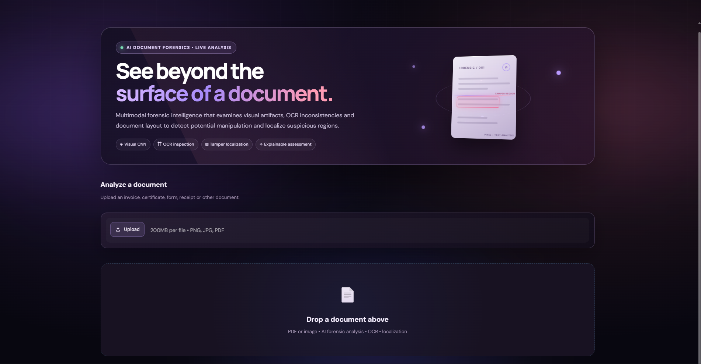

# AI-Based Document Forensics and Tampering Localization Using Deep Learning


An AI-powered document forensics system designed to detect document tampering, classify document authenticity, and localize suspicious regions using deep learning, OCR, and image analysis.


## Overview


Digital documents can be manipulated through image editing, text replacement, and other forms of tampering. This project explores a deep learning-based approach to identifying suspicious modifications in documents.


The system combines visual feature extraction, OCR-based text analysis, and document layout information to support document authenticity assessment and tampering localization.


## Key Features


\- Document authenticity classification.

\- Image-based tampering detection.

\- Suspicious region localization using U-Net.

\- Document feature extraction using ResNet18.

\- OCR-based text extraction using Tesseract.

\- Multimodal document analysis.

\- Visual highlighting of suspicious regions.

\- Forensic analysis reports.

\- Streamlit-based graphical interface.

\- PDF and image document input support.


## System Architecture


The project uses three major analysis components:


1\. \*\*Visual Analysis:\*\* Uses deep learning to identify visual inconsistencies in document images.

2\. \*\*OCR Analysis:\*\* Extracts document text using Tesseract OCR and supports text-based forensic analysis.

3\. \*\*Layout Analysis:\*\* Examines document structure and spatial information.


These components are evaluated individually and in combination through an ablation study.


## Technologies Used


\- Python

\- PyTorch

\- Torchvision

\- ResNet18

\- U-Net

\- OpenCV

\- NumPy

\- Pandas

\- Tesseract OCR

\- PyMuPDF

\- Scikit-learn

\- Streamlit


## Project Structure


```text

AI-Document-Forensics-Tampering-Localization/

│

├── app/

│   └── app.py

│

├── src/

│   ├── models/

│   │   ├── multimodal\_dataset.py

│   │   └── multimodal\_model.py

│   ├── forensic\_pipeline.py

│   ├── inference.py

│   ├── localization.py

│   ├── localization\_v2.py

│   ├── ocr.py

│   ├── train.py

│   ├── train\_multimodal.py

│   └── evaluate\_multimodal.py

│

├── results/

│   ├── ablation/

│   │   └── ablation\_results.txt

│   ├── evaluation/

│   │   └── multimodal\_metrics.txt

│   └── examples/

│

├── requirements.txt

├── .gitignore

└── README.md

```


## Dataset


The experimental dataset contains:


| Category | Number of Documents |

|---|---:|

| Authentic | 503 |

| Tampered | 503 |

| Total | 1,006 |


Dataset split:


| Split | Documents |

|---|---:|

| Training | 804 |

| Validation | 202 |


The complete dataset is not included in this repository.


## Model Evaluation


The following metrics are recorded in the project's evaluation output:


| Metric | Result |

|---|---:|

| Accuracy | 90.10% |

| Precision | 98.92% |

| Recall | 82.88% |

| F1-score | 90.20% |

| ROC-AUC | 88.78% |


These values are from the recorded evaluation metrics file. They should not be interpreted as independent test-set results unless the evaluation split is confirmed to be a held-out test set.


## Ablation Study


The project compares different combinations of document features.


| Configuration | Accuracy |

|---|---:|

| Visual + OCR | 90.10% |

| Visual + Layout | 89.60% |

| Visual + OCR + Layout | 89.11% |


In this experiment, Visual + OCR achieved the highest accuracy among the evaluated configurations.


## Installation


### 1. Clone the repository


```bash

git clone https://github.com/nandadarshanam1/AI-Document-Forensics-Tampering-Localization.git

cd AI-Document-Forensics-Tampering-Localization

```


### 2. Create a virtual environment


```bash

python -m venv venv

```


Activate it on Windows:


```powershell

.\\venv\\Scripts\\Activate.ps1

```


### 3. Install dependencies


```bash

pip install -r requirements.txt

```


### 4. Install Tesseract OCR


Install the Tesseract OCR engine separately. The Python package `pytesseract` does not install the OCR engine itself.


Configure the Tesseract executable path in the application if it is not automatically detected.


## Running the Application


From the repository root, run:


```bash

streamlit run app/app.py

```


The Streamlit application should open in your browser.


\*\*Note:\*\* Model checkpoints and the original dataset are not included in this repository. The application may require trained model weights and the corresponding dataset or configuration files before all analysis features can run.


## 🖥️ Application Preview

The project includes an interactive Streamlit dashboard with a modern interface for document forensic analysis.



Users can upload PDF or image documents for AI-assisted forensic examination, including OCR extraction, authenticity assessment and suspicious-region localization.
## Example Outputs


Sample outputs are available in:


```text

results/examples/

```


These include example predictions, masks, and tampering-highlighted document images.


## Limitations


\- Performance depends on the quality and diversity of the training dataset.

\- OCR accuracy can vary with document resolution, font, and image quality.

\- Detection results should be treated as forensic indicators, not definitive proof of document fraud.

\- The reported metrics reflect the recorded experimental evaluation and may not represent real-world performance.


## Future Improvements


\- Expand the dataset with more document types and tampering techniques.

\- Improve localization accuracy.

\- Evaluate generalization on independent external datasets.

\- Improve OCR and layout feature fusion.

\- Add more explainability and forensic visualization capabilities.


## Author


\*\*Nanda Darshanam\*\*


B.Tech, Computer Science and Engineering (Data Science)  

Dayananda Sagar University, Bengaluru


## License


This project is licensed under the MIT License. See the `LICENSE` file for details.


